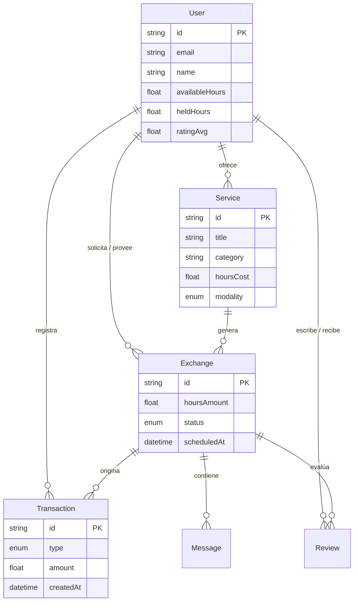

# ⏳ ChronoShare — Banco de Tiempo Universitario y Local

> **Trabajo Fin de Máster (TFM)** — Máster de Desarrollo con IA (BIG school)  
> **Estado del proyecto:** 🚧 Fase 1: Arquitectura, Diseño y Estructura Base (Entrega Fundae)

---

## 1. Descripción General del Proyecto

**ChronoShare** es una plataforma web donde las personas intercambian favores, clases o servicios **pagando únicamente con su tiempo en lugar de usar euros**. 

La regla es muy sencilla: **1 hora de tu tiempo vale exactamente lo mismo que 1 hora del tiempo de cualquier otra persona**, sin importar si das una clase de programación avanzada, ayudas a alguien con una mudanza o paseas a su perro.

### 💡 ¿Cómo funciona en la práctica? (Un ejemplo real)

Imagina que tres estudiantes de la misma universidad se registran en ChronoShare:

1. **El inicio:** Al registrarse, cada uno recibe **2 horas gratis** en su cuenta para poder empezar a pedir ayuda sin tener que esperar.
2. **Ana necesita ayuda:** A Ana se le da mal el inglés, así que busca en la web y encuentra a **Carlos**, que ofrece clases de conversación. Ana le pide **1 hora de clase**. El sistema le congela esa hora a Ana para asegurarle a Carlos que podrá cobrarla.
3. **El intercambio:** Dan la clase por videollamada. Al terminar, ambos confirman en la web que todo ha ido bien. En ese momento, esa **1 hora pasa de la cuenta de Ana a la de Carlos** (Ana se queda con 1 hora y Carlos sube a 3 horas).
4. **La cadena continúa:** Ahora **Carlos** tiene 3 horas acumuladas y decide gastar **2 horas** pidiéndole a **Lucía** que le ayude a configurar su ordenador. 

Nadie ha gastado un solo euro, todos han resuelto un problema real y el tiempo circula como si fuera dinero en un banco.

### ¿Qué problema técnico resuelve ChronoShare?
Los bancos de tiempo tradicionales suelen fracasar porque la gente desconfía ("¿y si doy una clase y luego la otra persona no me paga las horas?") o porque llevar las cuentas es un lío. ChronoShare automatiza todo esto funcionando como un banco real: **retiene las horas preventivamente** cuando se pide un servicio (*Escrow*), lleva un **libro contable exacto** de cada movimiento y exige **valoraciones mutuas** tras cada trato.

---

## 2. Funcionalidades Principales (MVP)

* **Monedero de Tiempo y Bono de Bienvenida:** Cada usuario recibe `2.0 horas` gratuitas al registrarse para dinamizar los primeros intercambios. El saldo se divide en *Horas Disponibles* (las que puedes gastar ya) y *Horas Retenidas* (las que tienes reservadas en tratos pendientes).
* **Marketplace de Servicios:** Catálogo con buscador y filtros por categoría (Académico, Tecnología, Idiomas, Hogar), modalidad (Online / Presencial) y coste en horas.
* **Sistema de Intercambio Seguro (Flujo de Estados):**
  1. `PENDING`: El solicitante pide un servicio y sus horas quedan bloqueadas preventivamente.
  2. `ACCEPTED`: El proveedor acepta la solicitud y se habilita el chat interno para acordar día y hora.
  3. `COMPLETED`: Tras realizar el servicio, ambos confirman y las horas se transfieren oficialmente al monedero del proveedor.
  4. `CANCELLED`: Si se cancela antes de realizarse, las horas retenidas vuelven automáticamente al solicitante.
* **Libro Contable Transparente:** Historial detallado estilo cuenta bancaria con todos los movimientos de ingresos, gastos y retenciones.
* **Sistema de Reputación Cruzada:** Valoraciones de 1 a 5 estrellas y comentarios obligatorios tras finalizar cada intercambio.
* **Asistente Inteligente Integrado (IA Generativa):**
  * *Copiloto de Publicación de Servicios:* A partir de una descripción breve e informal del usuario, la IA redacta automáticamente un título atractivo, estructura los puntos clave del servicio, asigna la categoría adecuada y sugiere una duración estimada en horas.
  * *Síntesis Inteligente de Reputación:* Analiza las valoraciones recibidas por un usuario tras sus intercambios para generar un resumen objetivo de sus puntos fuertes y etiquetas de confianza en su perfil.

---

## 3. Stack Tecnológico

El proyecto está construido bajo una arquitectura *Full-Stack* tipada de extremo a extremo, optimizada para el desarrollo asistido por IA:

* **Frontend & Backend:** [Next.js](https://nextjs.org/) (App Router) + [TypeScript](https://www.typescriptlang.org/)
* **Estilos e Interfaz (UI):** [Tailwind CSS](https://tailwindcss.com/) + [shadcn/ui](https://ui.shadcn.com/)
* **Base de Datos y Autenticación:** [Supabase](https://supabase.com/) (PostgreSQL)
* **ORM:** [Prisma](https://www.prisma.io/) (Gestión de esquema y transacciones ACID)
* **Entorno de Desarrollo:** Google Antigravity IDE
* **Despliegue (CI/CD):** [Vercel](https://vercel.com/)
* **Inteligencia Artificial:** [Google Gemini API](https://ai.google.dev/) (Generación estructurada mediante *Server Actions*)

---

## 4. Arquitectura y Modelo de Datos

El núcleo del sistema garantiza la integridad de los saldos mediante transacciones atómicas en PostgreSQL.



---

## 5. Estructura del Proyecto

```text
banco-tiempo-tfm/
├── docs/                   # Documentación y slides de presentación del TFM
├── prisma/
│   └── schema.prisma       # Esquema relacional de la base de datos
├── src/
│   ├── app/                # Rutas de la aplicación (Next.js App Router)
│   │   ├── (auth)/         # Vistas de inicio de sesión y registro
│   │   ├── dashboard/      # Panel principal del usuario y resumen de actividad
│   │   ├── explore/        # Catálogo y buscador de servicios
│   │   ├── services/[id]/  # Detalle del servicio y solicitud de intercambio
│   │   ├── exchanges/[id]/ # Chat interno y gestión de estados del trato
│   │   └── wallet/         # Historial contable de transacciones de horas
│   ├── components/
│   │   ├── ui/             # Componentes base (shadcn/ui)
│   │   └── shared/         # Componentes reutilizables (Navbar, ServiceCard)
│   ├── lib/
│   │   └── actions/        # Server Actions (lógica de negocio y transacciones)
│   └── types/              # Definiciones de tipos TypeScript
└── README.md               # Documentación principal del proyecto
```

---

## 6. Instalación y Ejecución Local

> *Nota: Actualmente el proyecto se encuentra en fase de arquitectura inicial. En las próximas iteraciones se añadirá el archivo `.env.example` y el script `seed.ts`.*

1. **Clonar el repositorio:**
   ```bash
   git clone [https://github.com/javiariasr/banco-tiempo-tfm.git](https://github.com/javiariasr/banco-tiempo-tfm.git)
   cd banco-tiempo-tfm
   ```

2. **Instalar dependencias:**
   ```bash
   npm install
   ```

3. **Ejecutar el servidor de desarrollo:**
   ```bash
   npm run dev
   ```
   Abrir [http://localhost:3000](http://localhost:3000) en el navegador.

---

## 7. Hoja de Ruta (Roadmap)

* [x] **Fase 1 (Entrega Fundae):** Definición funcional, diseño UX, modelado de base de datos (`schema.prisma`), estructura base del repositorio y presentación inicial.
* [ ] **Fase 2:** Configuración de Supabase, autenticación de usuarios y creación del script de datos de prueba (*seeding*).
* [ ] **Fase 3:** Desarrollo del Marketplace (CRUD de servicios y filtros de búsqueda).
* [ ] **Fase 4:** Implementación del motor de transacciones (`ESCROW`), chat interno y sistema de valoraciones.
* [ ] **Fase 5 (IA & Despliegue):** Integración de las funcionalidades de IA (Asistente de publicación y Síntesis de reseñas), despliegue en producción en Vercel y documentación final.


---

## 8. Entregables del TFM

* **URL de Despliegue:** *Pendiente de despliegue en Fase 5 (Vercel)*
* **Credenciales de Prueba:** *Se habilitarán tras el despliegue con datos precargados*
* **Presentación (Slides):** [Ver presentación en Google Slides](https://docs.google.com/presentation/d/1Pf2wUI2ddvGw63QsCVdu_hYTfcEnByPL2UHNbT7wDos/edit?usp=sharing) (también disponible en PDF dentro de la carpeta `/docs`)
* **Vídeo Demostrativo:** *(Añadir aquí el enlace público de YouTube/Drive tras grabar)*